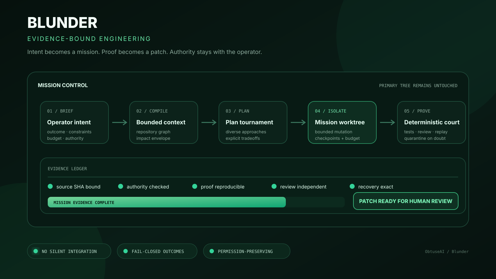
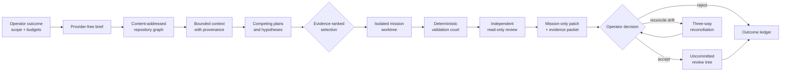
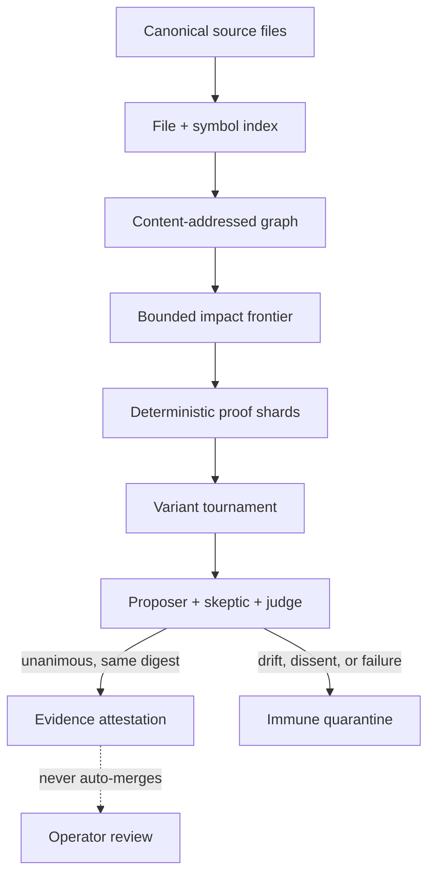
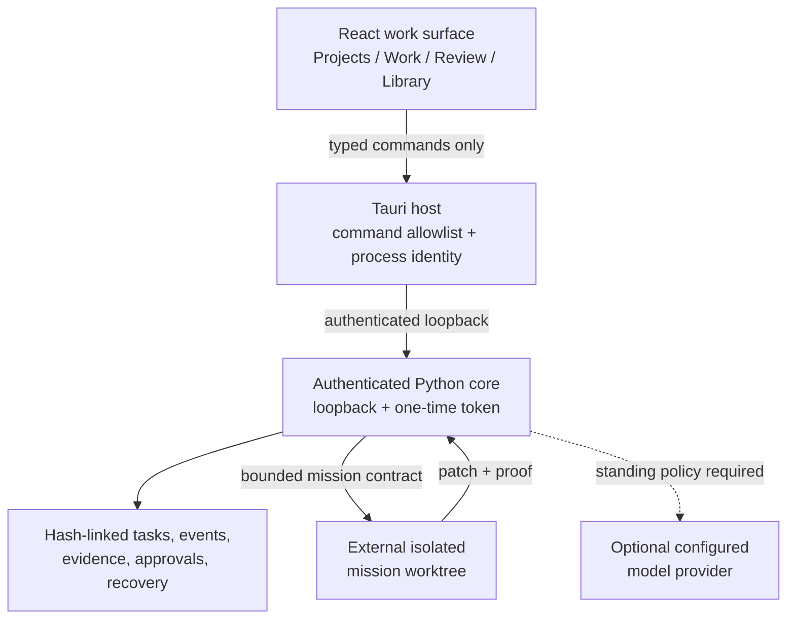

# Blunder

<div align="center">

**The evidence-bound engineering operating system for ambitious software work.**

Turn an outcome into an isolated mission. Let competing plans earn their place.<br>
Return a proved patch to a human-owned review tree.

[](https://github.com/ObtuseAI/blunder/actions/workflows/quality.yml)
[](https://www.python.org/)
[](https://tauri.app/)
[](.github/workflows/quality.yml)
[](LICENSE)

</div>



Blunder is a local-first control plane for software engineering with agents. It takes a product or code objective, compiles the relevant repository evidence, compares bounded implementation plans, runs the selected mission in an isolated Git worktree, and returns a mission-only patch with proof for operator review.

The important part is not that a model can write code. The important part is that understanding, planning, mutation, validation, review, recovery, and integration remain separate systems with different authority.

> Models may propose. Tools may measure. Evidence may narrow a decision.<br>
> None of them can silently grant themselves integration, release, credential, or constitutional authority.

## Product truth

| Contract | Current public state |
| --- | --- |
| **Portfolio role** | **Evidence-Bound Engineering Control Plane** — the company-level system for isolated agent missions, deterministic validation, and operator-owned integration. |
| **Maturity** | **Technical preview** |
| **Engineering evidence baseline** | [`04576053`](https://github.com/ObtuseAI/blunder/commit/04576053a2efe14bda56dd468f87049ccce3f327) · required cross-platform [quality workflow](https://github.com/ObtuseAI/blunder/actions/workflows/quality.yml) |
| **Proved now** | The public source implements repository intelligence, bounded planning, isolated worktrees, mission budgets, validation records, review, recovery, and patch-only handoff. |
| **Authority ceiling** | Blunder never auto-merges. The operator owns integration, release, credentials, provider spending, and changes to governing policy. |
| **Clean demonstration** | Follow the [core-service quick start](#core-service), then inspect the mission and validation surfaces without granting integration authority. |
| **Known limit** | A current public provider-backed API-to-desktop mission reaching reviewed handoff remains an open flagship proof; configured CI does not substitute for that end-to-end demonstration. |

**Designed for:** engineering leaders and product teams who need agentic speed without surrendering scope control, review quality, recovery, or source authority.

[Explore the ObtuseAI portfolio](https://github.com/ObtuseAI) ·
[Inspect the architecture](#why-this-system-exists) ·
[Start a technical conversation](https://github.com/ObtuseAI/blunder/issues)

## DumbMoney private-local profile

This private repository also contains **DumbMoney**, a Windows-first personal-prop
profile that federates Blunder, Doofus, Waterboy, Dummy/Kalshi, and
Dopey/Robinhood. It adds a signed fund kernel, proof-carrying research loop,
hard-capped OpenRouter gateway, sovereign venue cells, local release tooling,
and a read-only operator cockpit without moving broker credentials or execution
authority into Blunder.

The full design and current activation boundary are in
[DUMBMONEY_ARCHITECTURE.md](docs/DUMBMONEY_ARCHITECTURE.md). The source does
not enable live trading, install services, or claim profitability by itself.

## Blunder in one minute

| Question | Answer |
| --- | --- |
| **What is it?** | An engineering mission system, constitutional runtime, product studio, repository intelligence layer, and constrained desktop work surface. |
| **What goes in?** | A repository, an operator-owned objective, explicit scope, policy, and execution budgets. |
| **What comes out?** | A reviewable patch, exact validation records, independent findings, provenance, and an honest terminal state. |
| **What makes it unusual?** | It treats source mutation as a governed transaction rather than the natural consequence of a model response. |
| **What can it build?** | Python and polyglot software, websites, mobile apps, desktop surfaces, game projects, design systems, and supporting assets through typed project contracts. |
| **What does it refuse to do?** | Auto-merge, invent proof, convert confidence into authority, or hide missing evidence behind an optimistic status. |

## Why this system exists

Most coding-agent loops compress five very different questions into one:

1. What does the repository actually say?
2. What should change?
3. What is the agent allowed to change?
4. Did the change work?
5. Who decides whether it becomes source history?

That compression is convenient, but it makes collateral edits, stale context, self-review, scope drift, accidental privilege expansion, and untraceable recovery much harder to reason about.

Blunder decomposes the work into a mission protocol:



The primary checkout, mission worktree, runtime evidence, review-tree edits, and published commits are different states. Blunder does not silently upgrade one into another.

## A mission, end to end

Imagine an operator asks:

> Add a resilient offline state to a mobile application, change only the app shell and connectivity service, preserve the existing visual language, and prove behavior across compact and reduced-motion profiles.

Blunder turns that sentence into inspectable engineering objects:

| Stage | What Blunder does | What the operator can inspect |
| --- | --- | --- |
| **1. Brief** | Normalizes the outcome, named surfaces, path ceiling, acceptance criteria, denials, and budgets. | The exact mission contract before a provider is called. |
| **2. Repository intelligence** | Builds file, symbol, import, language, and source-hash records; traces likely consumers and contradictions. | Every context excerpt with its source path and digest. |
| **3. Plan tournament** | Produces bounded alternatives and scores precision, systems impact, adversarial risk, and proof cost. | Why a plan was selected, rejected, or left without a champion. |
| **4. Intent firewall** | Compares proposed hunks to the requested outcome and declared paths before writes. | Per-hunk scope alignment and collateral-change findings. |
| **5. Isolated execution** | Creates a claimed mission worktree with explicit time, call, token, cost, path, and effect ceilings. | Ownership, checkpoints, heartbeats, and budget consumption. |
| **6. Proof court** | Runs project-owned commands and typed product checks; binds results to source and artifact identity. | Exit codes, logs, hashes, device evidence, and failed gates. |
| **7. Independent review** | Reviews the patch read-only from a distinct context and checks deterministic findings again. | Findings, reviewer identity, agreement, and unresolved uncertainty. |
| **8. Handoff** | Produces the mission-only patch and an evidence packet. | A clean accept, reject, or reconcile decision without automatic merge. |

If no plan clears the evidence floor, the correct result is `NO_CHAMPION`. If a required screenshot is absent, promotion is blocked. If the primary branch moved during the mission, Blunder reconciles explicitly instead of pretending the original patch still applies cleanly.

## The system inside the system

Blunder is not one agent loop. It is a set of first-party control planes that share the same authority, evidence, and recovery model.

### 1. Mission Control

Mission Control owns the transactional engineering path:

- explicit source identity and preflight;
- isolated branches and worktrees;
- path claims and disjoint specialist ownership;
- checkpoints, heartbeats, cancellation, and exact recovery;
- execution, provider-call, token, time, and cost budgets;
- deterministic validation plus independent review;
- mission-only patch extraction;
- three-way reconciliation when the source has drifted;
- operator-owned application to an uncommitted review tree.

Multiple specialists can work in parallel only when their path claims are disjoint. Their outputs are synthesized and validated before any primary-tree handoff. Specialist work is never applied directly to the source tree.

### 2. Repository Intelligence and the Quorum Graph Kernel

Source files remain the canonical, diffable authority. Blunder derives a content-addressed semantic graph over files, symbols, imports, and containment without pretending that the graph replaces source.



This layer provides:

- stable file and symbol identities;
- reverse-dependency and forward-containment impact analysis;
- bounded validation micro-spaces for Python and Node proof;
- repeatability-aware candidate tournaments;
- three-context quorum with distinct proposer, skeptic, and judge identities;
- quarantine for digest drift, disagreement, missing roles, or regression;
- counterfactual branch history and family lineage;
- idle-capacity scheduling that still respects CPU, memory, thermal, queue, and authority limits.

Consensus is recorded as deterministic evidence, not described as formal mathematical proof.

### 3. Creation Forge

Creation Forge handles the part of engineering that should remain plural before it becomes precise. It develops multiple creative directions, product blueprints, and implementation hypotheses before converging.

Its outputs include:

- structured product briefs and user outcomes;
- typed prompt programs and trace records;
- alternative concepts that preserve meaningful diversity;
- falsifiable hypotheses with evidence paths and proof cost;
- quality-diversity selection instead of winner-take-all collapse;
- creative and technical grading bound to exact inputs;
- provenance-aware reuse and family history;
- a final blueprint that enters Mission Control without gaining extra authority.

The goal is not “more ideas.” It is to keep genuine alternatives alive long enough to compare them using the same proof discipline as code.

### 4. Product Studio

Product Studio translates a desired experience into technical contracts for real toolchains.

| Capability | Concrete behavior |
| --- | --- |
| **App Blueprint Compiler** | Defines audiences, journeys, navigation, data entities, loading/empty/error/offline/permission states, budgets, acceptance criteria, and authority denials. |
| **Visual Judgment Loop** | Parses PNG evidence, validates image integrity, measures pixel drift, and combines it with overflow, clipping, focus, and console evidence. |
| **Device Matrix** | Requires named desktop, tablet, phone, dark-mode, reduced-motion, offline, landscape, and high-scale profiles. |
| **Mobile Foundry** | Recognizes Expo, React Native, Flutter, Android, and iOS projects and emits typed test, doctor, simulator, debug, and preview-build plans. |
| **Web Production Lab** | Recognizes Next.js, Astro, SvelteKit, Nuxt, Vite, and static sites; inspects routes, metadata, semantics, CSP evidence, tests, and performance budgets. |
| **Game Studio** | Recognizes Godot, Unity, Unreal, and JavaScript engines; inventories scenes and assets; checks input, replay, export, headless validation, and runtime budgets. |
| **Design-System Forge** | Produces color, typography, spacing, radius, motion, breakpoint, component-state, and CSS-token contracts with computed contrast gates. |
| **Asset Intelligence** | Hashes and classifies images, SVG, audio, fonts, and 3D assets; checks byte, pixel, duplication, provenance, license, and active-content risks. |
| **Polyglot Intelligence** | Indexes symbols, imports, references, diagnostics, and structural changes across web, mobile, game, shader, and native languages. |
| **Product Evaluation Arena** | Compares product candidates against the same versioned suite and preserves a no-champion outcome when proof is insufficient. |

Blunder does not replace Xcode, Gradle, browser engines, Godot, Unity, or Unreal. It owns the contract, evidence, isolation, judgment, and authority boundary around those tools.

### 5. Constitutional Cognitive OS

The Constitutional Cognitive OS, or CCOS, is the durable governance substrate beneath missions and product work.

It supplies:

- immutable authority rules and versioned constitutional amendments;
- typed effect surfaces instead of arbitrary tool reach;
- causal event identities and hash-linked records;
- sealed evolution whose learned output cannot widen permission;
- exact checkpoints, retention, replay, and recovery;
- resource physiology, backpressure, and bounded scheduling;
- cognitive ecology for specialized workers and evidence exchange;
- canary proof across supported Python and operating-system combinations;
- operator observability without turning the display into an authority source.

High confidence, high reputation, repeated success, or a strong fitness score can affect ranking. None can grant credentials, deployment, publication, source integration, or constitutional mutation.

## The desktop is an authority boundary

Blunder vNext presents Projects, Work, Review, and Library in a native Tauri shell. The desktop is intentionally constrained.



The renderer does not receive the raw provider token. It has no arbitrary shell, filesystem, process-control, or direct-network capability. The Tauri host validates both the launcher and inner runtime identities before trusting the sidecar.

## Evidence is a product surface

Every important claim should be answerable with an artifact:

| Claim | Expected evidence |
| --- | --- |
| “This is the source I inspected.” | Commit, tracked-tree digest, file hash, symbol identity. |
| “This context supported the plan.” | Source path, excerpt, relevance, symbols, imports, SHA-256. |
| “This mission stayed in scope.” | Path ceiling, ownership claims, intent-diff findings, mission-only patch. |
| “This candidate worked.” | Project-owned commands, exit codes, logs, repeatability, artifact hashes. |
| “The UI did not regress.” | Exact device profile, screenshot digest, pixel delta, layout and console findings. |
| “Review was independent.” | Distinct reviewer context, same candidate digest, findings, verdict. |
| “Recovery is possible.” | Checkpoint identity, last-known-good state, recovery record, source reconciliation. |
| “The operator accepted it.” | Explicit review action and an uncommitted review-tree result. |

Blunder uses honest terminal states:

- `NO_CHAMPION` — no candidate cleared the evidence floor;
- `PROMOTION_BLOCKED` — required proof is missing, stale, malformed, or below policy;
- `REJECTED` — review found a material defect;
- `RECOVERY_BOUND` — recovery is constrained to the last-known-good state;
- `READY_TO_APPLY` — a bounded mission result is prepared for synthesis or review;
- an **uncommitted review tree** — the operator accepted the patch for inspection, not publication.

## What a successful handoff looks like

A completed mission is more than a diff:

```text
mission/
|-- contract.json              objective, scope, denials, budgets
|-- context/                   content-addressed repository evidence
|-- plans/                     alternatives, scores, selection rationale
|-- checkpoints/               recoverable mission state
|-- validation/                commands, logs, results, artifact identities
|-- review/                    independent findings and court verdict
|-- patch/mission.patch        only the owned mission changes
`-- outcome.json               terminal state and operator-facing decision data
```

The exact on-disk layout varies by runtime surface, but the separation is invariant: inputs, decisions, mutations, proof, and authority are not collapsed into one transcript.

## Quick start

### Core service

Requirements: Python 3.11+ and Git.

```powershell
git clone https://github.com/ObtuseAI/blunder.git
cd blunder
python -m venv .venv
.\.venv\Scripts\python.exe -m pip install --upgrade pip
.\.venv\Scripts\python.exe -m pip install -e .
.\.venv\Scripts\python.exe -m unittest discover -s tests
.\.venv\Scripts\blunder-core.exe --root .
```

The core service binds to loopback. Keep the generated token private and use the native host or documented contracts instead of exposing the service to a network.

### Desktop renderer

Requirements: Node.js 20+. Building the native host also requires the Rust toolchain pinned in [`rust-toolchain.toml`](rust-toolchain.toml).

```powershell
cd desktop
npm ci
npm run typecheck
npm run build
cargo check --locked --manifest-path src-tauri\Cargo.toml
```

Provider-backed missions are optional and require explicit configuration and standing policy. Repository intelligence, deterministic proof, the native test suite, and many planning surfaces remain local and provider-free.

## Release proof

The public workflow proves distinct layers on clean GitHub runners:

| Job | Environment | What it establishes |
| --- | --- | --- |
| **CCOS cross-platform matrix** | Windows and Ubuntu; Python 3.11 and 3.13 | Python/JavaScript compilation plus constitutional runtime and canary boundaries. |
| **Coverage** | Windows; Python 3.13 | The full native `unittest` suite under `coverage.py` with a blocking 78% line floor. |
| **Desktop proof** | Windows; Python, Node, pinned Rust | Authenticated sidecar build/smoke, `npm audit`, typecheck, renderer build, and locked Tauri host check. |
| **Release proof** | Fresh source archive at the exact GitHub SHA | The continuous proof court against materialized source rather than a developer workspace. |

Actions run with read-only repository permissions, third-party actions are pinned by commit, and concurrent stale proofs are cancelled. Runtime-dependent Windows Job Object and operator-workspace evidence remains local and explicitly classified.

## Repository map

```text
blunder/                  service, missions, cognition, governance, evidence
|-- api/                  authenticated loopback service and typed contracts
|-- capability_packs/     versioned first-party capability manifests
|-- *.py                  mission, graph, product, proof, and CCOS primitives
desktop/                  React renderer and Tauri native authority boundary
configs/                  bounded runtime, product, evaluation, and policy data
security/                 secret hygiene and public/private release checks
scripts/obtuse/           reproducible proof, release, and operator tooling
tests/                    authority, recovery, mission, product, and API proof
docs/                     architecture decisions and capability reports
```

Recommended reading:

1. [Blunder vNext roadmap](docs/blunder-vnext-roadmap.md) — product shape and permanent boundaries.
2. [Mission branches report](docs/blunder-mission-branches-report.md) — isolated execution and handoff.
3. [Product Studio report](docs/blunder-p21-p30-product-studio-report.md) — web, mobile, game, design, and asset contracts.
4. [Quorum Graph Kernel report](docs/blunder-p31-p40-quorum-kernel-report.md) — graph reasoning, micro-spaces, quorum, and quarantine.
5. [Creation Forge report](docs/blunder-p41-p50-creation-forge-report.md) — creative diversity and evidence-ranked convergence.
6. [CCOS operationalization](docs/blunder-ccos-operationalization-report.md) — durable runtime, recovery, and observability.
7. [Security policy](SECURITY.md) and [contribution guide](CONTRIBUTING.md).

## Who this is for

Blunder is most useful to:

- engineers studying trustworthy agentic development;
- teams that need model-assisted work without model-owned integration;
- tool builders exploring evidence, provenance, recovery, and permission systems;
- product engineers coordinating code, design, device, and asset proof;
- researchers comparing agent plans, variants, and review strategies under a shared contract.

It is intentionally more rigorous than a one-shot code generator and intentionally less permissive than an unattended release bot.

## Scope and limitations

Blunder is experimental engineering infrastructure, not a guarantee of correct software. Passing checks establishes only the named contracts against the exact source and environment tested.

It does not:

- prove universal safety, security, accessibility, or production fitness;
- replace human product judgment or repository ownership;
- grant itself provider credentials, network reach, deployment, publication, or merge authority;
- make an external toolchain available when that toolchain is absent;
- convert simulation, confidence, consensus, or internal fitness into real-world proof;
- eliminate the need to inspect the resulting patch.

External effects remain bounded by host policy, typed capability surfaces, deterministic gates, and explicit operator decisions.

## Citation and license

Citation metadata is available in [`CITATION.cff`](CITATION.cff).

Copyright © 2026 ObtuseAI. The source is available for evaluation, education, research, and portfolio review under the [ObtuseAI Source-Available License](LICENSE). Commercial, hosted, production, and redistribution rights require separate written permission.
