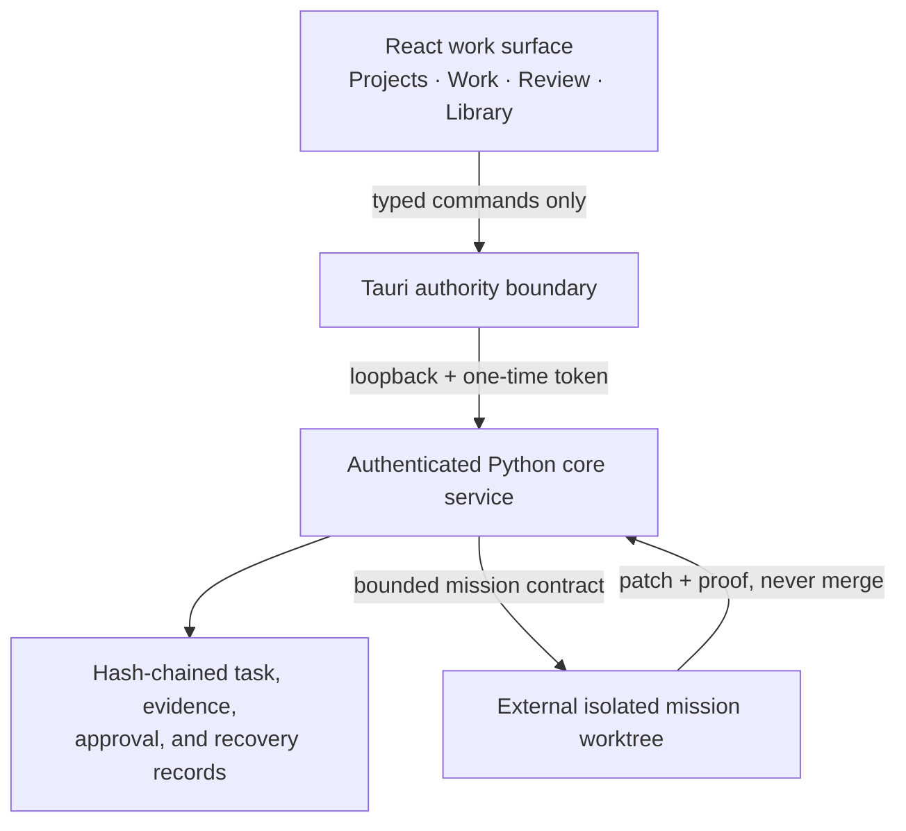
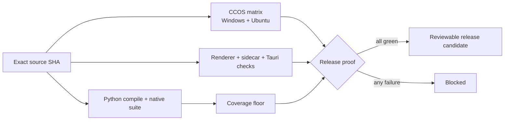

# Blunder

<div align="center">

**An evidence-bound engineering operating system for ambitious software work.**

Describe the outcome. Inspect the evidence. Promote only what proves itself.

[](https://github.com/ObtuseAI/blunder/actions/workflows/quality.yml)
[](https://www.python.org/)
[](https://tauri.app/)
[](LICENSE)

</div>


Blunder turns a software objective into a bounded, reviewable engineering mission. It compiles repository evidence, compares competing plans, executes inside an isolated worktree, runs deterministic and independent review, and returns a mission-only patch for operator approval.

It is deliberately not a chat box with shell access. Models can propose work; evidence and explicit authority decide what moves.

## Why Blunder exists

Most coding agents collapse understanding, planning, mutation, validation, and integration into one opaque loop. Blunder keeps those stages separate and inspectable.

| System | What it contributes |
| --- | --- |
| **Mission Control** | Isolated branches, worktrees, budgets, checkpoints, proof, reconciliation, and operator-owned integration |
| **Creation Forge** | Multiple creative directions, product blueprints, typed prompts, trace grading, and quality-diversity selection |
| **Quorum Graph Kernel** | Content-addressed repository topology, bounded impact analysis, independent consensus, and quarantine |
| **Constitutional Cognitive OS** | Immutable authority boundaries, typed effects, causal identity, sealed evolution, observability, and exact recovery |
| **Blunder vNext desktop** | A constrained Tauri work surface for Projects, Work, Review, and Library with an authenticated Python sidecar |

## System architecture

```mermaid
flowchart LR
    INTENT["Operator intent"] --> BRIEF["Provider-free briefing"]
    BRIEF --> GRAPH["Repository intelligence"]
    GRAPH --> CONTEXT["Bounded evidence compiler"]
    CONTEXT --> ROUTE["Capability routing"]
    ROUTE --> PLAN["Competing plan tournament"]
    PLAN --> MISSION["Isolated mission worktree"]
    MISSION --> COURT["Deterministic proof court"]
    COURT --> REVIEW["Independent read-only review"]
    REVIEW --> PATCH["Mission-only patch"]
    PATCH --> HUMAN{"Operator decision"}
    HUMAN -->|"accept"| TREE["Uncommitted review tree"]
    HUMAN -->|"reconcile"| DRIFT["Three-way reconciliation"]
    HUMAN -->|"reject"| LEDGER["Outcome evidence"]
    DRIFT --> HUMAN
    TREE --> LEDGER
    LEDGER --> LEARN["Permission-preserving learning"]
    LEARN -. "never expands authority" .-> ROUTE
```



Blunder separates primary source, mission worktrees, runtime evidence, review-state changes, and published commits. No stage silently upgrades one kind of state into another.

## What the desktop owns

The React renderer never receives the raw API token and has no shell, arbitrary filesystem, process-control, or direct-network authority. The Tauri host owns an authenticated Python sidecar, validates the launcher and inner runtime identities, and keeps provider-backed source work behind standing policy.



## Evidence before authority

Blunder is built around honest terminal states:

- `NO_CHAMPION` when no candidate clears the evidence floor;
- `PROMOTION_BLOCKED` when required proof is missing or stale;
- `REJECTED` when review finds a material defect;
- `RECOVERY_BOUND` when the last-known-good state constrains recovery;
- an uncommitted review tree when a human accepts a mission patch.

High model confidence, consensus, reputation, or fitness never grants credentials, deployment, integration, public-release, federation, or constitutional mutation authority.

## Quick start

### Core service

Requirements: Python 3.11+ and Git.

```powershell
git clone https://github.com/ObtuseAI/blunder.git
cd blunder
python -m venv .venv
.\.venv\Scripts\python.exe -m pip install --upgrade pip
.\.venv\Scripts\python.exe -m pip install -e .
.\.venv\Scripts\python.exe -m unittest discover -s tests
.\.venv\Scripts\blunder-core.exe
```

The service binds to loopback. Keep its generated token private and use the desktop host or documented API contracts rather than exposing it to a network.

### Desktop renderer

Requirements: Node.js 20+.

```powershell
cd desktop
npm ci
npm run typecheck
npm run build
```

Building the native Tauri host additionally requires the Rust toolchain pinned in [`rust-toolchain.toml`](rust-toolchain.toml).

## Release proof

The public quality workflow proves the same boundaries on clean GitHub runners:



The workflow uses read-only repository permissions and pinned third-party action commits. Local validation remains the source for runtime-dependent Windows Job Object and operator-workspace evidence.

## Project map

```text
blunder/                  core service, cognition, governance, missions, evidence
desktop/                  React + Tauri native work surface
configs/                  bounded runtime and policy configuration
security/                 secret hygiene and release-readiness checks
scripts/obtuse/           reproducible build, proof, and operator tooling
tests/                    native authority, recovery, mission, and API proof
docs/                     architecture, capability reports, and roadmap evidence
```

Start with:

- [Blunder vNext roadmap](docs/blunder-vnext-roadmap.md)
- [CCOS operationalization](docs/blunder-ccos-operationalization-report.md)
- [Creation Forge capability report](docs/blunder-p41-p50-creation-forge-report.md)
- [Security policy](SECURITY.md)
- [Contributing](CONTRIBUTING.md)

## Scope and limitations

Blunder is an experimental engineering control system, not a guarantee of correct software and not an autonomous release authority. Provider-backed missions require configuration and explicit policy. External effects remain bounded by the host environment, deterministic gates, and operator decisions. Passing tests demonstrate the checked contracts; they do not prove universal safety or production fitness.

## License

Copyright © 2026 ObtuseAI. The source is available for evaluation, education, research, and portfolio review under the [ObtuseAI Source-Available License](LICENSE). Commercial, hosted, production, and redistribution rights are not granted without separate written permission.
