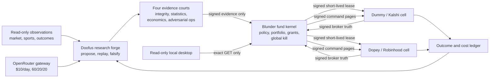

# DumbMoney private-local fund OS

Status: **local implementation under review; live activation is fail-closed**.

DumbMoney is a private, Windows-first personal-prop research and execution
profile built across the existing Blunder, Doofus, Waterboy, Dummy, and Dopey
repositories. It is not a monolithic trading bot. It is a federated control
system in which research can move quickly while broker authority remains inside
two sovereign venue cells:

- Dummy owns Kalshi data, credentials, reconciliation, risk checks, and order
  submission.
- Dopey owns Robinhood data, credentials, reconciliation, risk checks, and
  order submission.
- Blunder owns the portfolio policy, signed capital envelopes, global kill,
  control ledger, command feed, release evidence, and read-only cockpit.
- Doofus owns the autonomous research forge and proof-carrying candidate loop.
- Waterboy contributes candidate-only, point-in-time sports forecasts.
- The model gateway is the sole OpenRouter egress and enforces a hard $10 UTC
  daily budget.

The repositories remain separately testable and independently fail-closed.
Their databases, credentials, and broker adapters are not merged.

## System shape



There is no central cross-venue order executor. Core can reduce, pause, or
withhold authority. It cannot call either broker.

## Operating profile

The initial policy is `PERSONAL_PROP` with
`RISK_ACCEPTED_EXPLORATORY`. `FUND_MODE` is reserved and dormant.

| Control | Initial hard ceiling |
| --- | ---: |
| Combined designated NAV | 25% |
| Dummy / Kalshi sleeve | 12.5% NAV |
| Dopey / Robinhood sleeve | 12.5% NAV |
| One idea | 1% NAV |
| One correlated cluster | 3% NAV |
| Per-venue daily loss | 1.5% NAV |
| Combined daily loss | 3% NAV |
| High-water drawdown kill | 10% |
| OpenRouter | $10 per UTC day |

Every order must fit the remaining daily-loss budget as well as the order,
cluster, venue, and combined exposure ceilings. A configured ceiling is not a
target.

## Contract and authority flow

1. A research agent emits an immutable candidate and lineage record.
2. Trials run in a credential-free sandbox. Failed and aborted trials remain
   append-only evidence.
3. Independent courts emit evidence verdicts. A candidate cannot grade itself.
4. A separately signed promotion certificate narrows the allowed venue,
   instruments, loss, stage, and time window.
5. Core intersects the mandate, policy, witnessed broker truth, passport,
   promotion, and current portfolio state.
6. Core may issue a short-lived, signed `CapitalEnvelopeV1`.
7. The venue cell verifies the signature, venue-specific signer, account hash,
   maximum-ever fence, exact instrument, time window, and all local risk
   limits again at the broker sink.
8. The cell records `DISPATCHING` before any external write. Ambiguous writes
   are never retried.
9. Signed reconciliation and outcome receipts return to Core and the research
   ledger.

Each stage may narrow authority. No downstream component may enlarge it.

## Autonomous and recursive loop

The self-improvement loop is:

```text
observe
  -> propose a typed candidate or mutation
  -> run a sealed, credential-free experiment
  -> adversarially falsify
  -> evaluate in four courts
  -> retain, demote, or quarantine
  -> forward-shadow
  -> bounded canary only when separately authorized
  -> reconcile actual outcomes and total costs
  -> update evidence and resource allocation
```

Automatic negative actions are broad: abstain, shrink, quarantine, demote,
pause, kill, and rollback. Positive expansion is deliberately narrower:
research success cannot create credentials, add instruments, increase the
capital policy, change broker accounts, publish code, or deploy its own
mutation.

Compounding means allocating more of the already authorized envelope toward
strategies with fresh, after-cost, externally witnessed evidence. It never
means self-authorizing additional NAV.

## Durable truth and restart behavior

- Core uses a single-writer SQLite control ledger with full durability and
  hash-linked events.
- Venue cells persist the maximum fencing generation ever observed, including
  expired leases. Restart cannot resurrect an older grant.
- Command consumers persist a sequence-and-digest cursor. Historical signed
  kill/pause events remain effective during replay; expired positive authority
  never becomes active.
- Research journals serialize across local processes. Budget validation and
  append happen in one locked transaction.
- Every uncertain broker placement is retained as ambiguous until broker
  reconciliation proves a terminal result.
- Unknown account, order, position, loss, backup, or outcome state is never
  converted to zero.

## Model gateway

The gateway is a narrow text-completion service, not a general model proxy.
It provides:

- fixed research/evaluation/operations allocations of 60%/20%/20%;
- one globally in-flight request;
- a durable `RESERVED -> DISPATCHING -> SETTLED | AMBIGUOUS` state machine;
- no POST retry;
- exact model and provider routing with fallbacks disabled;
- dedicated-key usage attestation and cost reconciliation;
- ZDR, data-collection denial, and OpenRouter response-cache disablement;
- digest-only journals without prompts, completions, account data, or keys.

Secret-pattern filtering is defense in depth. The production service must run
under a separate Windows identity that cannot read venue credentials, broker
databases, account snapshots, or raw venue records.

## Private-local deployment

Production is one supervised instance of each service:

1. DumbMoney Core
2. Research Mesh
3. Model Gateway
4. Dummy / Kalshi cell
5. Dopey / Robinhood cell

All listeners bind to loopback. The production desktop attaches read-only to
the one supervised Core; it must not spawn a second Core. Desktop-owned child
processes are an explicit isolated development mode only.

Release manifests bind every executable and configuration asset to a digest.
Service commands resolve only inside the sealed local release. Credentials and
tokens are resolved from OS-protected stores and are never embedded in the
release, command line, migration archive, prompt, or log.

No component auto-commits, auto-pushes, opens a pull request, publishes
telemetry, or exposes a hosted control plane.

## Laptop migration

The entire Dummy repository and its large legacy ledger do not need to move.
Use the current source checkout and transfer only explicitly selected,
hash-manifested operational state after review.

Dopey migration is tiered and quarantined. OAuth tokens, cookies, browser
profiles, private keys, broker credentials, account snapshots, and hidden
secret paths are excluded. UTF-8, UTF-16, NUL-bearing, and encoding-uncertain
content is scanned or forced into an explicit binary review. Robinhood
authorization is re-established on the target machine.

Dummy's legacy ledger remains read-only and venue-local. A compact epoch is
planned from content-addressed evidence; the 25+ GiB database is not copied
into Core.

## Dummy execution/reconciliation checkpoint

Dummy now reserves every prospective Kalshi order at submitted notional plus
the general worst-case taker fee. Its read-only reconciliation reader combines
the current and historical order/fill tiers, settlement history, and open
positions with bounded pagination and stable double reads. Terminal order and
settlement observations become typed, domain-separated witnesses signed by
the sealed Dummy service identity. The restart-safe sweeper idempotently
projects fills before releasing order reservations and retains filled position
exposure until stable position absence and a matching settlement are both
witnessed. The service signature identifies which local service observed an
authenticated broker response; it is not an exchange signature.

This closes the in-process reservation and reconciliation primitives, but it
does not activate trading. Dummy now publishes the exact heads of its capital
SQLite journal, command-feed SQLite journal, and revisioned live-exposure
projection into Core's independently persisted signed ledger before broker
reads and after cycle mutations. Core rejects sequence regression and
same-sequence digest conflicts; Dummy verifies the signed checkpoint and
ledger-event proof before readiness can advance.

The production runner installs a sealed disabled execution harness that is
exactly broker-snapshot-bound but has no broker client, credential, submit
callback, or write method. It always reports `BLOCKED` with zero submitted
orders, so the service remains `RECONCILIATION_ONLY` while exercising the
production cycle boundary.

## Activation boundary

The implementation remains non-live until all release validation is `PASS`
and the following external evidence exists:

- sealed service binaries and command bindings;
- OS-protected role keys and distinct per-cell/read-only tokens;
- one supervised Core with a verified desktop attachment path;
- Model Gateway loopback-port ownership and service-SID/program firewall proof;
- target-side Dopey authorization and quarantined laptop-state import;
- live read-only validation of Dummy's implemented credential-owned,
  fully-paginated double-read Kalshi broker and reconciliation projections,
  resolving the previously observed resting order and open position;
- replacement of Dummy's disabled harness with a separately reviewed,
  order-capable sealed execution adapter that preserves the exact verified
  broker-snapshot binding;
- witnessed place/cancel/kill/restart drills for each venue;
- verified backups and restore tests;
- an attended mechanical canary with no unknown outcomes.

Software readiness, operational readiness, and demonstrated profitability are
separate claims. This architecture does not treat one as evidence for another.
