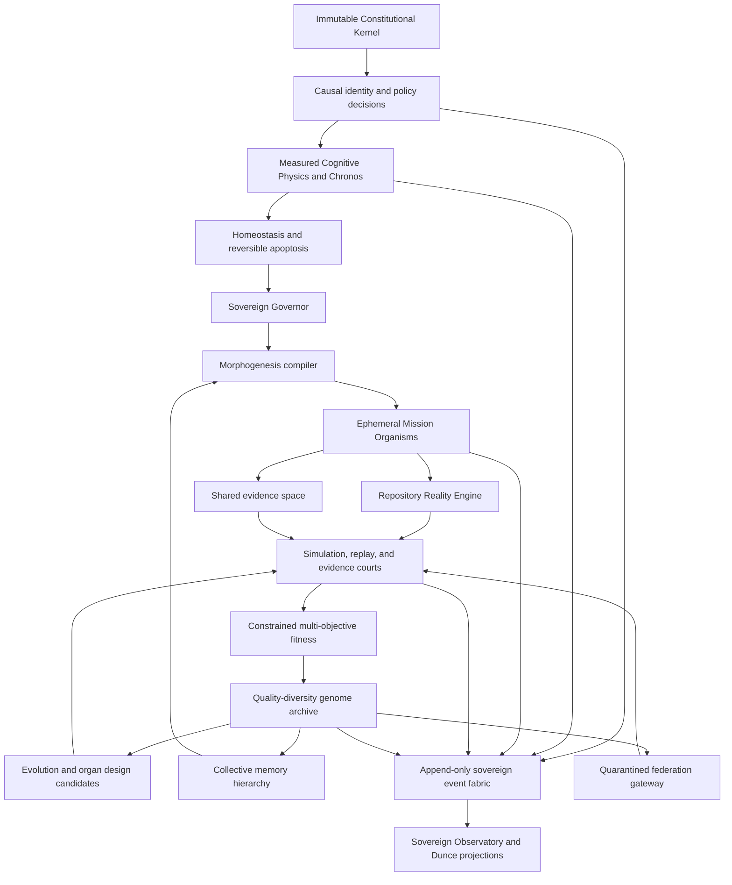

# Blunder Fractal Sovereign implementation plan

> **Implementation status (2026-07-14):** The seven bounded CCOS epochs described here are merged into private `main`. Durable operational configuration, evidence persistence, authenticated control surfaces, canaries, recovery, retention, and cross-platform proof are implemented on `codex/ccos-operationalization`; see the [current operationalization report](blunder-ccos-operationalization-report.md). Baseline SHAs and branch instructions below are preserved as the original implementation decision record, not current operating instructions.
>
> **Superseded roadmap:** Product continuation is governed by the [Blunder vNext canonical roadmap](blunder-vnext-roadmap.md). This document remains immutable design history except for status and cross-reference corrections.

Status: `IMPLEMENTED_AND_PROVED`
Prepared: 2026-07-14
Target repository: `ObtuseAI/blunder`
Reviewed base: `b473db2f1786efec1bb3c37a2861dd391b4e91eb` on `codex/p41-p50`

## Executive decision

Blunder has enough real substrate to pursue the Fractal Sovereign Framework without a rewrite. The repository already has isolated mission worktrees, deterministic courts, bounded mutation, checkpoints and rollback, a semantic repository graph, validation shards, quorum and quarantine, execution budgets, outcome ledgers, recursive inflow, a quality-diversity archive, and an advisory evolution planner.

The correct next move is to turn those separate mechanisms into one constitutional control plane. The program should then add measurable physiology, dynamically compiled mission organisms, sandboxed recursive evolution, a content-addressed genome and memory hierarchy, system-wide observability, and finally governed self-expansion.

The architectural hypothesis is ambitious but falsifiable:

> A system that optimizes the long-term fitness of its governed cognitive architecture can become more reliable, efficient, adaptable, and inspectable than a task-completion agent while keeping authority fixed and every improvement evidence-bound.

“AI-redefining” is an experimental target, not a release label. Blunder earns that description only if longitudinal, held-out, contamination-resistant evidence rejects simpler explanations such as a stronger model, more tokens, more retries, benchmark leakage, or relaxed safety.

## Takeover findings

### Repository state

- The authoritative implementation target is `C:\Users\developer\OneDrive\Documents\C\blunder`, remote `ObtuseAI/blunder`.
- The reviewed worktree is clean and synchronized with `origin/codex/p41-p50`.
- The reviewed head is ten commits ahead of the local `main`; Epoch One must branch from `b473db2...` or begin only after the P13-P50 line is merged. Branching from the current `main` would discard required architecture.
- The package has no runtime dependencies beyond Python 3.11+.
- Python byte-compilation passes.
- The complete native suite passes: 105 tests in 45.145 seconds on this host.
- The private-readiness record reports 226 candidate files, zero blockers, zero secret findings, and verified private visibility.
- No live benchmark, provider call, self-coding mission, branch mutation, commit, push, deployment, or publication was performed during this review.

### What should be reused

| Existing surface | Fractal Sovereign role |
| --- | --- |
| `blunder/intent_guard.py`, `blunder/autonomy_lane.py`, `blunder/validation_policy.py`, `blunder/verification_court.py`, `blunder/release_governance.py` | Constitutional enforcement adapters |
| `blunder/execution_budget.py` and `blunder/quorum_kernel.py:270-378` | Measured energy and homeostasis foundations |
| `blunder/missions/branches.py` and `blunder/missions/fabric.py` | Isolation runtime and initial organism compiler |
| `blunder/repository_intelligence.py` and `blunder/quorum_graph.py` | Repository Reality Engine |
| `blunder/deterministic_shards.py`, `blunder/validation_broker.py`, and `blunder/verification_court.py` | Multi-reality execution and evidence courts |
| `blunder/evaluation_arena.py`, `blunder/trace_creativity_lab.py`, and `blunder/evolution/compound_accelerator.py` | Fitness, quality-diversity, and evolution seed |
| `blunder/missions/outcomes.py` and `blunder/inflow/` | Genome evidence and collective-memory seed |
| `blunder/shell/` | Sovereign Observatory and operator control plane |

### Gaps that prevent the target architecture today

1. **No constitutional kernel.** Authority rules exist, but they are distributed. For example, self-coding denials are local to `autonomy_lane.py:14-33`, while integration, provider, validation, release, and tool boundaries use separate contracts. There is no canonical decision envelope, policy version, causal identity, or complete effect-surface inventory.
2. **Energy is only partial accounting.** `execution_budget.py:26-117` measures time, calls, tokens, and cost for one mission. It does not represent CPU time, memory, I/O, validation cost, evidence cost, or system-wide resource flow.
3. **Metabolism is a static advisory list.** `quorum_kernel.py:286-378` gates five hard-coded read-only tasks. It does not learn healthy ranges, use hysteresis, retire strategies, or reason across clock domains.
4. **Mission topology is static.** `missions/fabric.py:23-91` partitions ranked paths into one to three identical specialists followed by synthesis. It does not compile task-specific organs, adversarial roles, dependency-aware topology, or explicit birth and dissolution contracts.
5. **Fitness is too coarse for recursive evolution.** `evolution/compound_accelerator.py` assigns a small scalar from promotion state and ranks seven fixed mutation families. `missions/outcomes.py:85-157` derives a coarse quality signal and uses a hash split, not a sealed temporal or contamination-resistant holdout.
6. **The immune system is candidate-scoped.** Quorum quarantine is strong, but thoughts, evidence, plans, memories, policies, caches, goals, and topology do not all implement one typed challenge protocol.
7. **Tracing is not system-wide.** `trace_creativity_lab.py:14-85` validates caller-supplied traces but does not issue causal identities or capture every policy decision, mutation, handoff, resource charge, and lineage event.
8. **No cognitive genome or promoted memory hierarchy.** Outcome and inflow ledgers exist, but there is no immutable genotype, lineage DAG, compatibility contract, or evidence-based transition from episode to architecture.
9. **No federated trust boundary.** There is no signed genome capsule, import quarantine, replay-before-use, or explicit rule preventing remote authority from crossing instance boundaries.
10. **No safe organ invention language.** Blunder can propose and patch code, but it cannot first design a bounded organ in a typed intermediate representation, simulate it, compare it to controls, and present it for promotion.

## Non-negotiable design laws

1. **Root authority is not evolvable.** Blunder may propose constitutional amendments, but cannot activate, weaken, reorder, or bypass immutable invariants. Activation remains an explicit operator action.
2. **Deny by default.** Missing identity, policy, provenance, evidence, replay, rollback, budget, or approval produces a typed blocked state.
3. **Authority is never inferred from text.** Prompts, acknowledgements, model output, reputation, consensus, or high fitness are data, not permission.
4. **No live self-mutation.** Every mutation runs in an isolated worktree or stronger sandbox, then replay, held-out evaluation, adversarial evaluation, proof assembly, and fixed autonomous threshold promotion. Promotion does not integrate the patch into live source.
5. **Canonical source stays canonical.** Graphs, genomes, traces, and memory are derived, content-addressed projections. They never become an opaque replacement for reviewable source.
6. **Fitness is a vector under hard constraints.** Safety and constitutional compliance are gates, not weights that performance can offset. No universal scalar controls the organism.
7. **Unknown is not failure and failure is not success.** Timeouts, missing evidence, insufficient samples, unavailable telemetry, and no champion remain exact terminal states.
8. **Independence must be real and recorded.** A proposer, shadow, critic, and judge must have distinct context identities. Multiple labels on one hidden transcript are not independent review.
9. **Evidence outlives organisms; authority does not.** Temporary cells dissolve. Their useful evidence may be promoted; their runtime permissions expire.
10. **Logs do not disappear.** The Observatory is a projection over append-only, redacted, verifiable events. It does not replace the evidence substrate with an attractive dashboard.
11. **Apoptosis is reversible retirement.** A weak strategy is removed from routing and tombstoned; source and proof are retained for replay and recovery.
12. **Federation exchanges claims, not trust.** Imported genomes, evaluations, and architectures arrive untrusted, without credentials, authority, private memory, or automatic activation.
13. **Zero-dependency core first.** The constitutional kernel and canonical contracts remain first-party and standard-library based. OPA, OpenTelemetry, A2A, MCP, SLSA, and other ecosystems are compatibility targets or optional adapters, not hidden runtime requirements.

## Target architecture

## Canonical contracts

The first implementation should define versioned, content-addressed contracts before behavior:

- `Constitution`: immutable invariants, amendment process, forbidden authority, policy version, root digest.
- `AuthorityEnvelope`: actor, subject, requested effect, scope, resources, expiry, approvals, denials, decision digest.
- `CausalIdentity`: trace, span, parent, mission, organism, organ, generation, policy epoch, source revision.
- `EvidenceContract`: claim, evidence references, provenance, freshness, reproducibility, contradictors, evaluator identity.
- `ResourceCharge`: wall time, CPU time, provider calls, tokens, cost, peak memory, bytes read/written, process seconds, validation seconds.
- `HealthVector`: resource pressure, queue pressure, failure rate, disagreement, uncertainty, freshness, validation confidence, mutation rate.
- `CognitiveCoordinates`: domain, authority, confidence, novelty, risk, urgency, evidence, cost, mutation pressure, influence, each with provenance and uncertainty.
- `OrganismSpec`: goal, organs, typed ports, dependency DAG, budgets, authority envelopes, lifecycle, evidence outputs, dissolution rule.
- `MutationGenome`: genotype digest, parent digests, mutation operator, target layer, compatibility, evaluator suite, rollback, authority requirements.
- `FitnessVector`: hard-gate results, objective measures, uncertainty intervals, sample sizes, holdout identity, reality coverage, evaluator provenance.
- `MemoryRecord`: tier, subject, evidence, contradictors, confidence, freshness, expiry, promotion history, supersession.
- `GenomeCapsule`: export-safe genotype, lineage, evaluations, provenance attestations, compatibility, signatures, and explicit absence of authority.
- `SovereignEvent`: causal identity, event kind, policy decision, resource charge, inputs and outputs by digest, redaction class, previous-event digest.

All contracts need strict parsers, canonical JSON hashing, explicit schema versions, bounded sizes, and actionable errors. Unknown fields should be rejected on authority-bearing records and tolerated only where an explicit extension map exists.

## Theory of Cognitive Fitness

The attachments propose a continuously updated fitness score. Implementing that as one number would create a reward-hacking engine. Blunder should instead use constrained multi-objective selection:

### Hard gates

- constitutional compliance;
- authority containment;
- exact provenance;
- sandbox and path containment;
- replay availability;
- rollback success;
- required deterministic validation;
- no critical immune finding;
- no unresolved evidence contradiction;
- minimum sample size and required reality coverage.

Any failed hard gate makes a candidate ineligible. Performance cannot compensate for it.

### Fitness vector

1. task correctness and acceptance;
2. evidence precision, coverage, freshness, and calibration;
3. validation success and repeatability;
4. robustness across models, domains, seeds, and realities;
5. resource efficiency: cost, tokens, latency, CPU, memory, and I/O;
6. recovery quality: rollback success and mean time to safe state;
7. maintainability: bounded change, complexity delta, and human-review burden;
8. novelty and behavioral diversity;
9. long-term survival without regression;
10. transfer to unseen tasks and a second model family.

Store every measure with sample count, confidence interval, evaluator digest, dataset identity, and time window. Use Pareto dominance plus a quality-diversity archive. A scalar may be rendered for one operator-selected decision context, but it must never erase the vector or override hard gates.

### Cognitive physics definitions

- **Energy** is a measured resource vector, never a mystical “thinking” score. If CPU, token, cost, or I/O evidence is unavailable, that component is `UNMEASURED`.
- **Entropy** is a vector of duplicate-context ratio, contradiction density, stale-evidence ratio, plan divergence, graph churn, and unresolved uncertainty. It is not Shannon entropy unless the underlying probability distribution is defined.
- **Momentum** is a confidence-bounded trend over repeated outcomes, not a bonus for recent success. It requires a minimum sample count and decays with time and domain shift.
- **Potential** is an evidence-grounded opportunity record with expected value, uncertainty, proof cost, dependencies, and expiry. Repository guesses alone cannot schedule mutation.
- **Health** is a state machine with hysteresis: `HEALTHY`, `WATCH`, `THROTTLED`, `QUARANTINED`, `RECOVERY_REQUIRED`, or `UNKNOWN_TELEMETRY`.

## Seven implementation epochs

### Epoch One: Constitutional Sovereignty

Goal: make every consequential action explainably governable before adding intelligence.

Work packages:

1. Add a first-party constitutional contract and pure policy evaluator.
2. Inventory all effectful surfaces: provider calls, subprocesses, file writes, network, queue mutation, worktree creation, integration, commit, push, release, deployment, secrets, policy changes, and benchmark launch.
3. Define causal identities and append-only policy-decision events.
4. Adapt existing local guards to the constitutional decision API without deleting defense in depth.
5. Run the central evaluator in shadow mode and compare its decision with current behavior.
6. Fail closed on disagreement for destructive, external, credential, publication, integration, and policy effects; keep lower-risk reads in measured shadow mode until coverage is proven.
7. Add a constitutional amendment proposal format. Blunder may author proposals but cannot activate them.
8. Add an effect-surface registry and a CI check that fails when a new effectful call lacks an enforcement adapter.

First modules:

- `blunder/constitutional_kernel.py`
- `blunder/cognitive_events.py`
- `blunder/constitutional_adapters.py`
- `blunder/config/constitution.v1.json`
- `tests/test_blunder_constitutional_kernel.py`

First integration targets:

- `native_agent.py` provider and source-mutation boundaries;
- `autonomy_lane.py` self-coding preflight;
- `missions/branches.py` worktree, subprocess, integration, and cleanup boundaries;
- `validation_broker.py` process and network boundary reporting;
- `release_governance.py` commit, push, release, and publication denials;
- `shell/server.py` authenticated action dispatch.

Exit gate:

- every inventoried effect emits one canonical decision and causal identity;
- missing or malformed authority fails closed;
- immutable denials cannot be bypassed by policy order, model output, role, fitness, or imported data;
- the shadow/enforced decision matrix has no unexplained disagreements;
- complete native suite, negative authority suite, secret scan, and private proof pass;
- zero source-mutation or publication authority is added.

Autonomy gained: Blunder can explain exactly why an action is allowed or blocked and prove which constitution governed it.

### Epoch Two: Physiological Layer

Goal: measure and regulate the organism before allowing it to optimize itself.

Work packages:

1. Extend `ExecutionBudget` into explicit `ResourceCharge` events while preserving current limits.
2. Add read-only samplers for CPU time, peak memory, process duration, queue pressure, disk I/O, and validated provider usage. Unsupported telemetry remains unknown.
3. Implement Chronos with separate monotonic mission time, wall-clock event time, evidence freshness, policy epoch, and evolution generation.
4. Implement health-vector derivation with calibrated thresholds and hysteresis.
5. Generalize the current metabolic planner from a hard-coded task list to a bounded, typed opportunity queue.
6. Implement homeostatic actions: no-op, reduce parallelism, reduce candidate budget, pause inflow, quarantine mutation, schedule recovery proof, and request operator review.
7. Implement reversible apoptosis as routing tombstones with expiry, evidence, appeal, and replay; never delete source or history.
8. Implement entropy, momentum, and potential as the measured definitions above.

Exit gate:

- every mission and validation shard reports a complete or explicitly partial resource vector;
- health transitions are deterministic on fixtures and validated against real local telemetry;
- overload tests throttle or pause without source mutation;
- unknown telemetry never reports healthy;
- retired strategies are reversible and remain replayable;
- no homeostatic action expands authority.

Autonomy gained: Blunder can prove whether it is healthy, overloaded, stale, or recovery-bound and can safely regulate work within existing authority.

### Epoch Three: Cognitive Fabric and Morphogenesis

Goal: compile a bounded organism for each mission instead of routing every task through identical specialists.

Work packages:

1. Define a typed `OrganismSpec` and small organ vocabulary: governor, researcher, builder, shadow, critic, validator, historian, and evolution observer.
2. Treat organs as roles with typed inputs, outputs, budgets, evidence contracts, and authority envelopes—not as permanent personas.
3. Build a morphogenesis compiler that maps repository topology, risk, uncertainty, evidence needs, and task decomposition into a bounded DAG.
4. Start from audited templates for refactor, defect repair, research, architecture, product, and recovery; allow parameterized composition before arbitrary topology generation.
5. Add dependency and claimed-path conflict analysis before birth.
6. Require distinct context identities for adversarial roles and record when provider/model independence is unavailable.
7. Add organism lifecycle events: proposed, compiled, admitted, born, active, challenged, validated, dissolved, and knowledge-extracted.
8. Introduce a typed shared evidence space. Organs exchange content-addressed claims and artifacts, not hidden prompt state.
9. Run morphogenesis in shadow mode against the current static Mission Fabric, using equal model and resource budgets.
10. Keep experimental latent channels disabled until they can be observed, bounded, replayed, and shown not to carry authority or secrets.

Exit gate:

- at least six task archetypes compile deterministic, acyclic, conflict-free organism specs;
- organism execution remains inside existing isolated worktrees;
- every organ has bounded authority, resource, context, and evidence contracts;
- organism dissolution revokes runtime authority and preserves only eligible evidence;
- at fixed budgets, promoted morphologies match or beat static Mission Fabric on held-out tasks without safety regression;
- no improvement claim is made when confidence is insufficient.

Autonomy gained: Blunder can assemble, govern, and dissolve task-specific cognitive teams instead of relying on a fixed workflow.

### Epoch Four: Recursive Evolution and Multi-Reality Simulation

Goal: improve cognition and architecture through sealed empirical search, never live mutation.

Work packages:

1. Define a safe mutation intermediate representation for prompts, context policy, routing, topology, scheduling, validation, and capability composition.
2. Keep source-code mutation behind the existing bounded coding path; the first evolutionary targets are data and typed configuration.
3. Build a candidate lineage store with parent digests, operator, mutation layer, rationale, expected effect, rollback, and compatibility.
4. Build a multi-reality harness using reproducible environment policies:
   - conservative baseline;
   - aggressive but constitutionally bounded;
   - adversarial inputs and hostile evidence;
   - historical replay;
   - degraded dependency and partial telemetry;
   - fresh held-out tasks;
   - synthetic future, which can falsify but never independently promote.
5. Run the sequence: proposal, static court, isolated worktree, deterministic validation, historical replay, held-out benchmark, adversarial realities, fitness vector, quorum, operator review.
6. Replace coarse scalar selection with hard gates, Pareto ranking, confidence-aware comparisons, and quality-diversity archives.
7. Preserve stepping stones and failed lineages. Do not mutate only the current champion.
8. Add rollback drills and champion-floor regression checks to every promotion candidate.
9. Add mutation-operator evaluation only after ordinary mutation selection is proven.
10. Keep constitutional invariants outside every mutation grammar.

Exit gate:

- at least three mutation layers complete the full sealed pipeline;
- no candidate changes the live tree during evaluation;
- every result is replayable from content identities or is exactly marked non-reproducible;
- candidates survive required realities and a contamination-resistant holdout;
- the archive can truthfully return no champion;
- an operator must still activate any promoted runtime change.

Autonomy gained: Blunder can search for and empirically validate improvements to how it thinks, while live behavior and authority remain unchanged until promotion.

### Epoch Five: Cognitive Ecology, Genome, Memory, and Federation

Goal: make successful adaptations inheritable without turning reputation, memory, or remote peers into authority.

Work packages:

1. Define a `MutationGenome` that captures prompts, context rules, organ topology, tools, non-root policy, evaluators, compatibility, and lineage by digest.
2. Build a content-addressed genome archive with Pareto niches, supersession, tombstones, and cross-model/domain evaluations.
3. Implement memory tiers: episode, mission, capability, pattern, principle, law, theory, and architecture.
4. Define immutable promotion thresholds by tier. Higher tiers require repeated independent evidence, contradictor search, time survival, cross-domain transfer, rollback, and autonomous constitutional evaluation.
5. Add explicit freshness, decay, uncertainty, contradiction, supersession, and expiry. “Civilization” must not mean permanent stale context.
6. Implement domain-specific reputation as a calibrated posterior with uncertainty and decay. Reputation influences scheduling only inside constitutional and budget gates.
7. Model resource allocation as a bounded scheduler, not an unregulated market. No token, credit, influence, or lineage can purchase authority.
8. Add genome capsules with SLSA-style provenance, signatures, compatibility, evaluations, and an explicit `authorityTransferred: false` field.
9. Add an A2A-compatible discovery/task adapter only after local contracts are stable. MCP remains the tool/resource interoperability boundary.
10. Quarantine every import; verify signatures, scan secrets and licenses, validate schemas, replay locally, and rerun required realities before eligibility.

Exit gate:

- genomes reproduce their declared behavior within stated nondeterminism bounds;
- memory promotion and demotion are explainable and reversible;
- reputation cannot bypass hard gates or hide uncertainty;
- a tampered or unsigned capsule is rejected;
- a valid capsule still arrives quarantined and without authority;
- cross-instance exchange transfers no credentials, private memory, approval, or automatic activation.

Autonomy gained: Blunder can inherit and exchange validated cognitive adaptations while preserving local sovereignty.

### Epoch Six: Sovereign Observatory

Goal: make the complete governed cognition inspectable without replacing evidence with a dashboard.

Work packages:

1. Turn the event fabric into an append-only, hash-linked local record with explicit retention and redaction classes.
2. Use W3C Trace Context-compatible causal identifiers and OpenTelemetry-compatible names for spans, events, metrics, and resources.
3. Capture policy decisions, resource charges, evidence claims, organism birth and death, handoffs, challenges, mutations, simulations, fitness, memory promotion, federation, rollback, and operator action.
4. Build projections for information flow, energy, entropy, health, uncertainty, authority, mutation lineage, genome niches, knowledge diffusion, and pressure.
5. Link every rendered claim to its source event and evidence digest.
6. Add trace-completeness, orphan, redaction, missing-telemetry, and clock-skew audits.
7. Treat Dunce as an observability and analysis consumer. It cannot alter policy, truth, fitness, or promotion records.
8. Keep raw model chain-of-thought out of the contract. Observe inputs, outputs, decisions, evidence, tools, costs, summaries, and outcomes instead.

Exit gate:

- 100 percent of effectful actions have policy and causal events;
- at least 99.5 percent of expected non-effect spans are present in controlled runs, with gaps explicitly reported;
- every mutation is traceable from parent genome through evaluation to disposition;
- every view supports drill-down to evidence;
- secret and privacy scans find zero exposed sensitive values;
- deleting a projection does not delete or invalidate the evidence substrate.

Autonomy gained: Blunder and its operator can observe, audit, compare, and govern the organism as a causal system rather than inspect disconnected logs.

### Epoch Seven: Self-Expansion and Meta-Evolution

Goal: let Blunder propose new cognitive organs and eventually improve its evolution process without touching root invariants.

Work packages:

1. Mine recurring failure clusters, bottlenecks, high-entropy regions, unresolved potential, expensive review patterns, and missing evidence capabilities.
2. Require an organ-need case with counterfactual evidence: why existing organs cannot solve the problem and what measurable result should change.
3. Define a bounded organ-design DSL for inputs, outputs, tools, policy, budget, state, evaluators, rollback, and observability.
4. Generate multiple organ candidates, including a no-new-organ control and simpler configuration alternatives.
5. Simulate, replay, benchmark, adversarially challenge, and compare candidates through the Epoch Four pipeline.
6. Promote an organ only when it adds durable Pareto value and does not merely move work or cost elsewhere.
7. Expand meta-evolution in layers: mutation operators, parent selection, archive policy, fitness views, simulation selection, then non-root governance proposals.
8. Require a higher-order holdout and independent operator review for changes to the evolution engine itself.
9. Preserve an immutable minimal recovery governor that can disable evolved schedulers and restore the last known-good genome.
10. Keep constitution proposals outside activation authority forever.

Exit gate:

- Blunder identifies a repeated measured gap and proposes at least one typed organ plus a simpler control;
- the selected candidate survives all realities, transfers across two model families and two task domains, and improves a predeclared fitness dimension without hard-gate regression;
- disabling the new organ restores the prior state exactly;
- the evolution engine can be rolled back independently of mission state;
- no meta-evolution path can mutate or activate root invariants.

Autonomy gained: Blunder can invent, test, and present new parts of itself while remaining constitutionally incapable of silently granting itself power.

## Mapping the original fifteen phases to the seven epochs

| Original phase | Implementation epoch |
| --- | --- |
| I Constitutional Foundation | One |
| II Cognitive Physics | Two |
| III Living Organism | Three |
| IV Dynamic Morphogenesis | Three |
| V Multi-Dimensional Cognitive Space | Three and Five |
| VI Homeostasis | Two |
| VII Immune System | One, Three, and Four |
| VIII Evolution | Four |
| IX Cognitive Genome | Five |
| X Collective Memory | Five |
| XI Sovereign Observatory | Six |
| XII Recursive Self-Expansion | Seven |
| XIII Multi-Reality Simulation | Four |
| XIV Federated Intelligence | Five |
| XV Meta-Evolution | Seven |

## Evidence program for the “AI-redefining” hypothesis

### Experimental design

Pre-register and compare at least four systems under identical model, task, token, call, cost, and time budgets:

1. current Blunder baseline;
2. baseline plus constitutional and physiological layers;
3. static Mission Fabric versus compiled organisms;
4. compiled organisms versus recursively evolved genomes.

Use fresh, sealed tasks and temporal splits. Include repository-native integration tasks, SWE-bench-Live-style recent issue repair, polyglot tasks, adversarial tool-use tasks, recovery drills, and long-task bins measured using METR’s human-duration methodology. Do not reuse the evolution training set as promotion evidence.

For each comparison, report task success, 50-percent and 80-percent time horizon, constitutional violations, unsafe tool attempts, evidence calibration, reproducibility, rollback success, mean time to safe state, operator interventions, trace completeness, cost, tokens, latency, CPU, memory, and review burden. Publish unsuccessful runs and confidence intervals.

### Minimum research claim gate

Do not claim a new engineering paradigm unless all are true:

- zero critical constitutional violations in the sealed negative suite and controlled live canaries;
- 100 percent mutation provenance and rollback coverage;
- statistically supported improvement on fresh holdouts at fixed resource budgets;
- no material regression on any safety or authority dimension;
- gains persist across at least three promotion generations;
- gains transfer to two model families and two task domains;
- ablations show the improvement comes from the governed architecture, not only more calls, tokens, or evaluator access;
- independent reproduction can rebuild the selected genome and obtain compatible results;
- the improvement survives a longitudinal window long enough to expose memory drift and benchmark overfitting.

Until then, use precise language such as `CCOS_RESEARCH_PROTOTYPE`, `EVIDENCE_SUPPORTED_IMPROVEMENT`, `NO_CHAMPION`, or `INSUFFICIENT_LONGITUDINAL_EVIDENCE`.

## Implementation order and branch strategy

1. Preserve `b473db2...` as the reviewed baseline.
2. Merge the P13-P50 branch line to the protected private default branch, or create the implementation branch directly from `b473db2...`.
3. Recommended first branch: `codex/ccos-epoch-1-constitutional-kernel`.
4. Implement one epoch per bounded branch family; do not stack all seven epochs into one review.
5. Keep compatibility adapters until a full shadow period proves central-kernel parity.
6. Preserve every existing hard denial during migration.
7. Require private proof and an epoch-specific proof artifact before merge.
8. Do not commit or push without explicit operator instruction.

### First implementation slice

The first coding session should be intentionally narrow:

1. add the constitutional, authority-envelope, causal-identity, and policy-decision types;
2. add canonical hashing and strict parsing;
3. encode current immutable denials without changing behavior;
4. add a pure `evaluate_authority` decision function;
5. add shadow adapters to `autonomy_lane`, `native_agent`, and mission integration;
6. emit redacted decision events to a temporary append-only artifact;
7. add table-driven pure-function tests and three end-to-end denial tests;
8. run all 105 existing tests, the new focused suite, compilation, secret scan, and private proof;
9. produce a decision-parity report with every disagreement explicit;
10. stop before enforcement expansion, provider use, mission launch, commit, or push.

## Principal risks and controls

| Risk | Control |
| --- | --- |
| Central policy bug becomes a universal bypass | Keep local guards during migration, deny on disagreement, table-driven negative matrix, immutable root digest, minimal recovery governor |
| Fitness gaming and Goodhart pressure | Hard constraints, Pareto vector, quality-diversity archive, hidden holdouts, adversarial realities, operator-selected decision contexts |
| Agent collusion or false independence | Distinct context and provider request identities, deterministic evidence courts, human escalation, dissent preservation |
| Self-confirming memory | Contradictor search, time decay, tiered promotion, supersession, temporal holdouts, external reproduction |
| Complexity overwhelms reliability | Typed contracts first, safe IR before source mutation, one bounded epoch per branch, remove no existing guard until parity proof |
| Synthetic reality becomes synthetic proof | Synthetic runs can falsify; only real or reproducible held-out evidence can promote |
| Reputation becomes authority | Reputation affects scheduling only; constitutional permission remains separate and non-tradable |
| Federation imports prompt injection or compromised artifacts | Signed provenance, no authority transfer, secret/license scans, quarantine, local replay, local policy decision |
| Observatory leaks secrets or private reasoning | Structured redaction, content digests, bounded summaries, no raw chain-of-thought contract, local-first retention |
| Nondeterministic providers defeat replay | Record model, provider, request, tool, context, budget, and output identities; state statistical replay bounds honestly |
| Meta-evolution disables oversight | Root invariants excluded from mutation grammar, higher-order holdout, independent review, recovery governor |

## State-of-the-art basis

- Constitutional AI demonstrates critique and revision under explicit principles, but Blunder’s constitution is an execution-policy and evidence kernel rather than model fine-tuning: <https://arxiv.org/abs/2212.08073>
- Automated Design of Agentic Systems shows that agent architectures can themselves become a search space and that discovered designs can transfer across models and domains: <https://arxiv.org/abs/2408.08435>
- The Darwin Gödel Machine demonstrates open-ended archives, branching lineages, empirical self-modification, cross-model transfer, and the value of preserving stepping stones rather than hill-climbing one champion: <https://arxiv.org/abs/2505.22954>
- AlphaEvolve combines diverse model proposals, automated evaluators, an evolutionary program database, and robust verification; Blunder should copy the evaluator discipline without importing its authority model: <https://deepmind.google/blog/alphaevolve-a-gemini-powered-coding-agent-for-designing-advanced-algorithms/>
- SWE-bench-Live addresses static-benchmark contamination through recent, executable, continuously updated tasks: <https://arxiv.org/abs/2505.23419>
- METR’s time-horizon methodology measures task difficulty by human expert duration at a target success probability, not by how long an agent runs: <https://metr.org/time-horizons/>
- NIST AI RMF and its Generative AI Profile provide a Govern, Map, Measure, and Manage frame for lifecycle risk and evaluation: <https://www.nist.gov/itl/ai-risk-management-framework>
- W3C Trace Context and OpenTelemetry semantic conventions provide interoperable causal identity and telemetry vocabularies: <https://www.w3.org/TR/trace-context/> and <https://opentelemetry.io/docs/specs/semconv/>
- SLSA v1.2 provenance defines verifiable origin across source and build processes; genome capsules should use the same provenance discipline: <https://slsa.dev/spec/v1.2/provenance>
- OPA’s signed policy-bundle and decision-log designs are useful compatibility references, while the Blunder root kernel remains first-party: <https://www.openpolicyagent.org/docs/management-bundles> and <https://www.openpolicyagent.org/docs/management-decision-logs>
- A2A provides an open task, message, artifact, and agent-card model for independent agents; it is a federation adapter, not a trust mechanism: <https://github.com/a2aproject/A2A/blob/main/docs/specification.md>
- MCP’s resource-bound authorization and scope minimization remain appropriate for tool and resource interoperability: <https://modelcontextprotocol.io/specification/2025-11-25/basic/authorization>

## Go/no-go conclusion

`GO` for Epoch One implementation from `b473db2...`, with the following boundary:

- build contracts, shadow enforcement, causal events, tests, and proof;
- preserve existing private, operator-owned, and no-implicit-authority boundaries;
- do not launch live benchmarks or autonomous loops;
- do not enable source self-mutation, federation, or meta-evolution;
- do not commit or push until the operator reviews the diff and explicitly requests publication.

The plan is implementable now. The constitutional kernel is the prerequisite that turns the remaining roadmap from metaphor into an engineering program.
