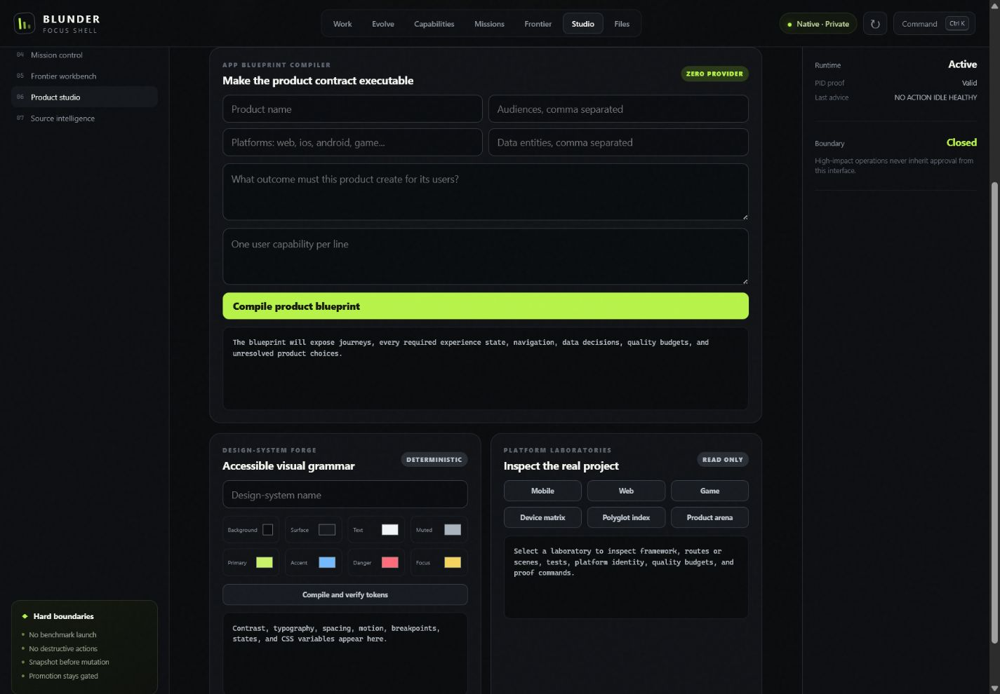

# Blunder Product Studio: P21-P30

## Outcome

Blunder Product Studio is a first-party product-engineering control plane for mobile apps, websites, UI/UX systems, games, assets, and cross-platform products. It sits above framework-specific toolchains and below operator release authority.

It does not attempt to replace Expo, Xcode, Gradle, Flutter, browser engines, Godot, Unity, or Unreal. Blunder owns the product contract, source understanding, evidence format, budgets, visual and device judgment, mission isolation, evaluation, permissions, and release boundary. Project toolchains remain typed execution targets.

The complete control flow is:

```text
user outcome
  -> app blueprint
  -> design-system contract
  -> platform and polyglot inspection
  -> isolated implementation mission
  -> project-owned validation commands
  -> device and visual evidence
  -> asset, accessibility, and performance gates
  -> product arena
  -> operator-reviewed integration
  -> separately authorized preview, export, store, or deployment workflow
```

## P21: App Blueprint Compiler

`blunder/app_blueprint.py` validates a structured request and compiles:

- product name, user outcome, audiences, and target platforms;
- domain classification without hiding the original platform list;
- one stable product surface for every user capability;
- initial, loading, ready, empty, error, offline, and permission-denied states;
- actor-specific journeys, recovery branches, and measurable outcomes;
- navigation edges and back-state behavior;
- data entities with unresolved ownership, retention, and offline-conflict decisions;
- domain-specific mobile, web, game, or desktop quality budgets;
- acceptance criteria and explicit authority denials.

Blueprint compilation is deterministic and provider-free. Similar capability names that collapse to the same stable identifier are rejected instead of silently overwriting a surface.

## P22: Visual Judgment Loop

`blunder/visual_judgment.py` implements PNG analysis with the Python standard library. It verifies:

- PNG signature and chunk boundaries;
- CRC integrity for every chunk;
- standard compression and filter modes;
- non-interlaced 8-bit grayscale, RGB, or RGBA evidence;
- Sub, Up, Average, and Paeth filter reconstruction;
- a 32 MiB source and 20-megapixel decompression ceiling.

Comparison records exact source hashes, dimensions, changed pixels, changed percentage, mean channel delta, and the smallest bounding box containing visual drift. The verdict also consumes layout evidence for overflow, clipping, focus visibility, and console errors. Mismatched dimensions fail rather than being rescaled into a misleading comparison.

## P23: Device Matrix

`blunder/device_matrix.py` defines eight first-party profiles:

1. wide desktop in light mode;
2. keyboard desktop in dark mode;
3. portrait touch tablet;
4. compact portrait phone;
5. landscape dark-mode phone;
6. reduced-motion phone;
7. offline phone;
8. high-scale compact desktop as a zoom and text-reflow proxy.

Each measurement must include a content-addressed screenshot, overflow, clipping, console and page errors, interaction failures, critical accessibility count, and elapsed time. Missing or unexpected profiles fail completeness.

## P24: Mobile App Foundry

`blunder/mobile_foundry.py` recognizes Expo/React Native, React Native, Flutter, native Android, and native iOS projects. It inspects:

- supported platforms;
- iOS bundle and Android application identifiers;
- automated test surfaces;
- accidental checked-in signing material;
- framework-appropriate type, doctor, test, debug, simulator, and preview-build commands.

EAS preview builds are marked as external and credential-bearing. Every command is emitted with `executionAuthorized: false`; store submission and credential mutation remain false.

## P25: Web Production Lab

`blunder/web_lab.py` recognizes Next App Router, Astro, SvelteKit, Nuxt, Vite, and static HTML projects. It checks routes, production scripts, metadata, semantic main content, document language, responsive contracts, tests, robots policy, and Content Security Policy evidence.

The lab carries explicit LCP, INP, CLS, and critical-accessibility budgets. A static inspection can reach `READY_FOR_EXECUTABLE_PROOF`; it cannot claim that a production build, browser matrix, real-user performance measurement, or deployment has occurred.

## P26: Game Studio

`blunder/game_studio.py` recognizes Godot, Unity, Unreal, and common JavaScript game engines. Its inventory covers scenes, scripts, textures, audio, and models. Readiness requires:

- a configured main scene;
- input mapping;
- automated test evidence;
- a deterministic replay surface;
- export configuration;
- a headless validation command;
- 60 FPS, p95 frame-time, crash, replay-divergence, and input-latency budgets.

Game export remains unauthorized until the operator explicitly opens it.

## P27: Design-System Forge

`blunder/design_system.py` converts an explicit palette and scale request into:

- normalized color tokens;
- mathematically calculated WCAG contrast ratios;
- body, muted, primary, accent, danger, and focus gates;
- modular typography;
- spacing and radius scales;
- motion and reduced-motion values;
- responsive breakpoints;
- eight complete component states;
- CSS custom properties.

An invalid palette produces `FAIL_CONTRAST_GATES`; Blunder does not modify the requested colors to fabricate a pass.

## P28: Asset Intelligence

`blunder/asset_intelligence.py` scans supported project assets while excluding generated and dependency trees. It can extract PNG, GIF, JPEG, SVG, and WAV facts and classify fonts and 3D assets. It verifies:

- per-asset and total byte budgets;
- image-pixel budgets;
- SHA-256 identity and duplicate payloads;
- provenance source and explicitly allowed license;
- SVG scripts, event handlers, and external resources;
- WAV channels, sample rate, duration, and sample width.

Oversized assets are hashed by streaming and rejected without loading the complete payload into memory. Provenance must stay within the project root.

## P29: Polyglot Intelligence

`blunder/polyglot_intelligence.py` provides deterministic lexical and language-pattern intelligence for TypeScript, JavaScript, CSS, Swift, Kotlin, Dart, C#, GDScript, shader languages, and HTML/Vue/Svelte markup.

The index records path, language, content hash, size, symbols, imports, and diagnostics. Reference search uses identifier boundaries across every supported language. Delimiter and string checks are deliberately reported as deterministic lexical analysis, not as a substitute for each platform compiler or language server.

Native Blunder source policies now recognize the corresponding product roots and text formats, including `apps`, `packages`, `src`, `public`, `assets`, `ios`, `android`, `game`, and `games`. Existing path confinement, protected directories, intent firewall, review, validation, checkpoints, and mission isolation still apply.

## P30: Product Evaluation Arena

The versioned suite in `configs/obtuse/blunder-product-evaluation-suite.json` contains:

- resilient mobile onboarding;
- production web delivery;
- deterministic game loop;
- accessible design-system engineering;
- cross-platform coherence.

Each candidate supplies the exact reports required by its case. Report evidence contributes 70 percent of the normalized score. Journey completion, accessibility, performance, intervention, elapsed-time, and cost gates contribute 30 percent. Passing requires every report and experience gate plus the case score threshold.

An operator-accepted candidate that fails the objective gates is recorded as a false accept. External baselines require a source, measurement timestamp, 64-character measurement digest, and result provenance. An empty arena returns `NO_CANDIDATES`.

## Product Studio IDE

The seventh Focus Shell surface provides:

- a product-name, audience, platform, entity, goal, and capability composer;
- direct blueprint compilation;
- accessible color inputs and design-token compilation;
- current-root mobile, web, and game inspection;
- the complete device matrix;
- polyglot indexing;
- the current Product Arena state.

Every endpoint is authenticated by the existing session token and bound to the shell's exact root. The Studio does not accept an arbitrary browser-supplied filesystem root.

## Operator commands

```powershell
$blunder = "scripts\obtuse\blundercode.ps1"

powershell -NoProfile -ExecutionPolicy Bypass -File $blunder product blueprint configs\obtuse\blunder-app-blueprint.example.json
powershell -NoProfile -ExecutionPolicy Bypass -File $blunder product design configs\obtuse\blunder-design-system.example.json
powershell -NoProfile -ExecutionPolicy Bypass -File $blunder product device
powershell -NoProfile -ExecutionPolicy Bypass -File $blunder product audit web
powershell -NoProfile -ExecutionPolicy Bypass -File $blunder product polyglot
powershell -NoProfile -ExecutionPolicy Bypass -File $blunder product arena
```

The direct Python adapter also accepts another project root for read-only platform, asset, or language inspection. Product Arena still resolves its versioned suite from the Blunder installation that owns the invocation.

## Verified review-tree evidence

| Proof | Result |
| --- | --- |
| P21-P30 focused integration | 10/10 passed |
| Complete Blunder suite | 89/89 passed |
| Blueprint example | `READY_FOR_PRODUCT_PLANNING` |
| Design-system example | `PASS`; all six contrast gates passed |
| Device Matrix | 8 profiles emitted; execution authority false |
| Product Arena without evidence | `NO_CANDIDATES`; zero fabricated baselines |
| Live Studio browser workflow | Blueprint, design-system, Device Matrix, and Product Arena actions completed with zero console warnings or errors |
| Desktop-wide Studio layout | 1,425 CSS pixels usable width with zero horizontal overflow; screenshot preserved below |
| Mobile fixture | Expo project reached `READY_FOR_EXECUTABLE_PROOF` with store submission false |
| Web fixture | semantic responsive static site reached `READY_FOR_EXECUTABLE_PROOF` |
| Game fixture | Godot project reached `READY_FOR_HEADLESS_PROOF` with export false |
| Visual fixture | real PNG decoding and zero-diff comparison passed |
| Asset fixture | dimensions, provenance, license, duplicate, byte, and pixel gates passed |
| Polyglot fixture | TypeScript, Swift, and HTML indexed; cross-language references resolved |
| Current-shell polyglot index | JavaScript, markup, and CSS indexed; 675 symbols; zero diagnostics |
| Current Studio screenshot judgment | First-party PNG decoder verified 1,410,750 pixels with zero layout or console violations |
| S-tier capability audit | 184/184; no failed or critical gates; idle runtime healthy |
| Private-repository readiness | `ObtuseAI/blunder` verified private; zero secret findings |

These fixtures validate the first-party contracts and failure behavior. They are not claims that Blunder has already built and shipped a real app or game in this review tree. A real product becomes an arena candidate only after its own executable, visual, device, asset, accessibility, and performance evidence exists.


