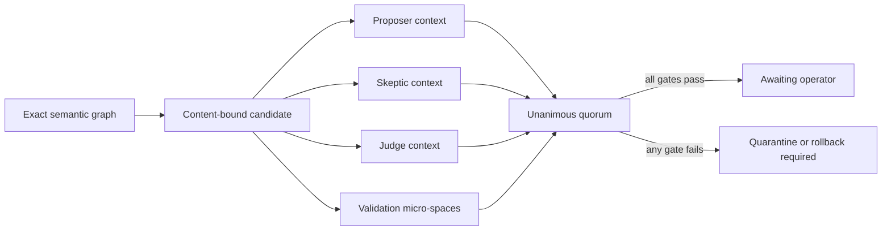

# Blunder Quorum Graph Kernel: P31-P40

## Outcome

The Blunder Quorum Graph Kernel turns the useful parts of the Biomimetic Quorum Kernel idea into a first-party engineering control plane that is executable on the current Windows host, reviewable in Git, and honest about its isolation and proof strength.

The kernel does not replace files, claim machine-code graph execution, promise microsecond shards, call deterministic attestations formal proofs, or consume 100 percent of idle hardware. It connects Blunder's existing repository intelligence, mission worktrees, validation broker, verification court, checkpoints, evolution policy, and idle runtime through stricter graph and evidence contracts.

## Architectural judgment

### Ideas retained

- Treat code as a live semantic topology for reasoning and impact analysis.
- Bind every experiment to exact input, output, graph, and source identity.
- Separate creative proposal, adversarial challenge, and deterministic judgment.
- Quarantine disagreement or drift before it can become source mutation.
- Use idle capacity continuously when measured resource and safety gates permit it.
- Preserve counterfactual branches and their evidence instead of flattening experiments into logs.

### Ideas deliberately corrected

| Generated idea | Blunder implementation |
| --- | --- |
| Eliminate source files | Source files remain the canonical, diffable authority; the semantic graph is a derived projection. |
| Execute a single in-memory AST as the operating system | Build a content-addressed graph over files, symbols, and imports while the existing runtime remains explicit and inspectable. |
| Claim microsecond WASM isolation | Run only allowlisted Python and Node proof through the existing process broker; record whether a Windows Job Object or inherited parent-job boundary was actually obtained. |
| Explore ten thousand variants automatically | Cap suites at sixteen shards, parallel width at four, and repeats at five, with time and memory budgets on every shard. |
| Merge the fastest result automatically | Rank only passing repeatable evidence and send the winner to quorum; automatic merge remains false. |
| Treat consensus as formal proof | Emit a deterministic evidence attestation and set `formalMathematicalProof: false`. |
| Use all idle CPU/GPU capacity | Require operator-idle, foreground-mission, CPU, memory, thermal, queue, and destructive-authority gates; resource saturation remains forbidden. |

## P31-P40 capability map

| Priority | Capability | Operational contract |
| --- | --- | --- |
| P31 | Content-Addressed Semantic Graph | Stable file and symbol nodes, import and containment edges, source hashes, graph fingerprint, changed-path identity, and an explicit derived-graph authority statement |
| P32 | Reactive Impact Frontier | Reverse dependency propagation from changed files to consumers plus forward containment propagation into owned symbols, capped at eight layers |
| P33 | Deterministic Validation Micro-spaces | Allowlisted `python-unittest`, `python-compile`, and `node-check` processes; sanitized environment; requested process and memory limits; repeated normalized-output digests; exact isolation reporting |
| P34 | Variant Tournament | Passing, repeatability, measured mean latency, and stable candidate identity determine rank; no eligible evidence produces no champion |
| P35 | Three-Context Quorum | Exactly one proposer, skeptic, and judge with three distinct context identities must bind the same candidate and proposal digest and approve unanimously |
| P36 | Immune Quarantine | Digest mismatch, role absence, shared context, dissent, critical findings, failed proof, regression, court rejection, path escape, or checkpoint failure quarantines the candidate and raises rollback when it was already applied |
| P37 | Bounded Metabolic Planner | Real telemetry and explicit budgets select read-only semantic, proof, contradiction, or recovery-planning work only while every gate remains open |
| P38 | Counterfactual Timeline | A sealed DAG connects the canonical graph, candidate fork, shard transcripts, quorum attestation, and separate operator gate without deleting alternatives |
| P39 | Proof-Carrying Promotion | Per-file content digests form the proposal digest; votes, graph identity, checkpoint identity, shard transcripts, court result, and regression result form the final proof digest |
| P40 | Kernel Control Plane | Authenticated loopback API, native CLI, first-party capability pack, command palette entry, and dedicated IDE surface |

## Semantic topology

`blunder/quorum_graph.py` converts the repository intelligence index into stable graph nodes and edges:

```text
canonical source file
  -> contains -> symbol
  -> imports  -> dependency file
```

The graph fingerprint includes every node's content identity and every edge. A file change therefore changes the graph identity even when its path is unchanged.

Impact propagation follows the semantics of each edge:

- a changed file invalidates its contained symbols;
- a changed dependency invalidates every importing consumer;
- every returned layer is bounded, ordered, and content-addressed.

The graph never writes source and never becomes an alternative hidden repository.

## Deterministic validation micro-spaces

`blunder/deterministic_shards.py` accepts only three command families. Targets are confined to the workspace, unittest selectors are syntactically restricted, the environment excludes credentials, and each process receives explicit time and memory requests through `blunder.validation_broker`.

Every repetition records:

- the graph-bound input digest;
- return code;
- elapsed milliseconds;
- raw and normalized output digests;
- redacted bounded output tail;
- broker type;
- requested and applied process/memory boundary evidence;
- final transcript digest.

On the current Codex-hosted Windows process, the nested Job Object request is blocked by the inherited parent policy. Blunder records `INHERITED_PARENT_JOB` and does not claim the requested kernel memory limit was independently applied. The allowlisted commands still passed and repeated identically.

## Quorum and immune response

The quorum decision is intentionally stricter than three model messages saying yes.



The proposal SHA-256 is recomputed from an ordered list of `{path, contentSha256}` records. This prevents three roles from agreeing on an unbound label while reviewing different content.

Approval still does not authorize integration, commit, push, deployment, or release. It means only that a content-bound candidate is eligible for operator review.

## Metabolic scheduling

The metabolic planner does not infer that the operator is idle. It requires telemetry with:

- explicit operator-idle state;
- foreground mission state;
- current CPU utilization;
- available memory;
- thermal state;
- queue failure count;
- destructive-authority state.

Budgets cap task count, elapsed seconds, CPU threshold, and minimum free memory. If any gate fails, the selected task list is empty. The included configuration is labeled as operator-supplied example telemetry and is not reported as a live machine measurement.

## Operator commands

```powershell
$blunder = "scripts\obtuse\blundercode.ps1"

powershell -NoProfile -ExecutionPolicy Bypass -File $blunder kernel snapshot
powershell -NoProfile -ExecutionPolicy Bypass -File $blunder kernel graph
powershell -NoProfile -ExecutionPolicy Bypass -File $blunder kernel impact configs\obtuse\blunder-kernel-impact.example.json
powershell -NoProfile -ExecutionPolicy Bypass -File $blunder kernel shards configs\obtuse\blunder-kernel-shards.example.json
powershell -NoProfile -ExecutionPolicy Bypass -File $blunder kernel metabolism configs\obtuse\blunder-kernel-metabolism.example.json
```

Quorum and timeline commands require a caller-supplied candidate, exact change-set digests, three independent votes, and real shard reports. Blunder does not generate fake independent votes to make the demonstration pass.

## Verified review-tree evidence

| Proof | Result |
| --- | --- |
| Kernel, shell, and capability focused suite | 43/43 passed |
| Complete Blunder suite | 99/99 passed |
| Kernel snapshot | `OPERATIONAL`; P31-P40 surfaces present; automatic merge false |
| Current semantic topology | 1,482 nodes across 209 files and 1,273 symbols; 1,536 edges including 263 imports |
| Impact example | `PASS`; 118 nodes, 6 files, and 112 symbols across 4 bounded layers from `blunder/quorum_kernel.py` |
| Validation shard suite | 2/2 shards passed at active parallel width 2; 4/4 repeated runs stable |
| Isolation reporting | Current host reported `INHERITED_PARENT_JOB`; independent kernel memory-limit guarantee false |
| Metabolic example | `READY_FOR_BOUNDED_IDLE_ANALYSIS`; three tasks and 130 seconds; explicitly example telemetry |
| Quorum fixture | Fully bound unanimous candidate reached `QUORUM_APPROVED_AWAITING_OPERATOR` with every mutation authority false |
| Immune fixture | Skeptic rejection with a critical finding produced `QUARANTINED` |
| Capability fabric | Seven first-party packs, thirty skills, forty-six tools, and seven hooks |
| Live authenticated IDE workflow | Kernel loaded, impact passed, micro-space proof passed, metabolism paused without idle evidence and became ready only after explicit idle state |
| Desktop-wide visual QA | 1,425 CSS pixels usable width, zero horizontal overflow, and zero browser console warnings or errors |
| First-party PNG judgment | `PASS`; 1,410,750 pixels, zero changed pixels, zero layout violations, screenshot SHA-256 `56B424F7...CE0D` |
| Native integration proof | `PASS`; all eight architecture checks and 62 focused tests passed |
| S-tier autonomous capability audit | 184/184; zero failed gates and zero critical failures |
| Private repository readiness | `READY_FOR_PRIVATE_GITHUB_REVIEW`; private visibility verified and zero secret findings |


## Honest remaining frontier

The kernel is a powerful engineering spine, not a replacement operating system. The largest honest next steps are:

1. execute candidate-specific shard suites inside external mission worktrees rather than only the current review tree;
2. connect real operating-system telemetry to the metabolic planner through a read-only signed sampler;
3. add language-native AST adapters beyond Python and lexical polyglot symbols;
4. add optional WASM execution only after its host-call, filesystem, clock, entropy, and memory boundaries are proven on the target machine;
5. run real proposer, skeptic, and judge model contexts through Mission Fabric and preserve their provider request identities;
6. add formal methods only for selected contracts where a theorem prover or model checker genuinely produces a checkable certificate.

Those are evidence-producing extensions. None are claimed complete by this implementation.
